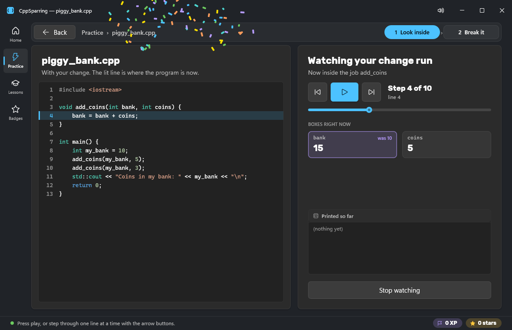
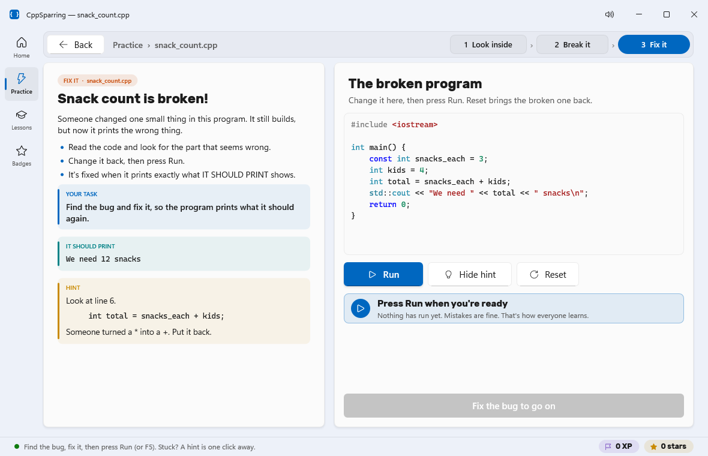
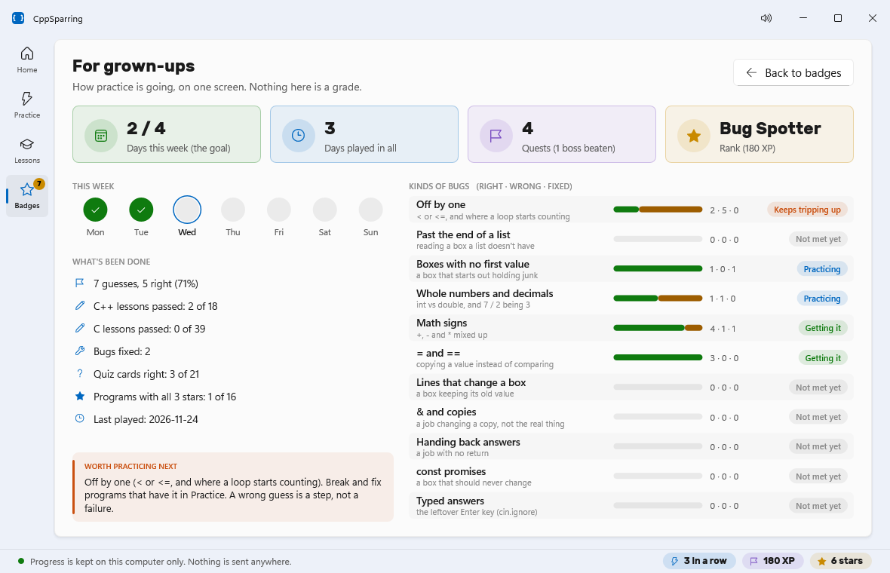
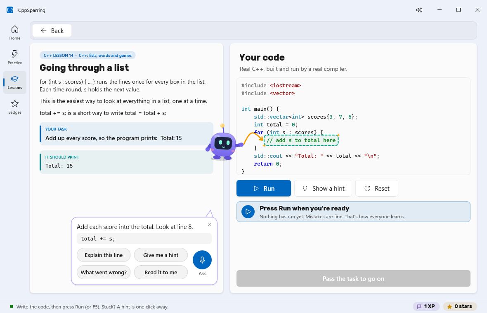

<p align="center"></p>

# CppSparring

**Learn C++ by breaking real programs.**

CppSparring is a Windows 11 app for beginners. It takes a small C++ program, changes one thing about it (takes away a `&`, turns
`==` into `=`, starts a loop at 1 instead of 0, deletes a line), and asks you: *what do you think will happen?* Then it builds and runs both versions for real and
shows you what actually happened, and why.

There is no AI guessing involved. Clang reads the program, the changes come from a fixed set of rules, and every answer comes from
really compiling and running the code.


## What's inside

- **Daily Quest**: one big button, five short steps (about five minutes): a quiz card, a guess, a little code to write, a bug
  to fix, another quiz card. A treasure chest at the end.
- **Bug Boss**: every third quest. Five quick guesses; each right one knocks it back, and right answers in a row build a combo. The
  timer is off unless you switch it on.
- **Practice**: sixteen programs in five levels (boxes, jobs, loops, blueprints, lists and games). Look inside a program first, with every part
  explained in plain words, then try to break it, then fix it.
- **Fix it**: CppSparring breaks the program for real (it keeps trying changes until one really changes what it prints, crashes it
  or stops it building) and hands it to you to repair. It's fixed when it prints what the working program printed.
- **Watch it run**: step through a program line by line and see every box (variable) change.
- **Lessons**: 24 C++ lessons (up to vectors, strings and rock-paper-scissors) and 39 C lessons where you write the code yourself and the compiler checks what it prints. The C
  lessons come from [CodingTeacher](https://github.com/mrtitanic777/CodingTeacher). The last six, **Bugs to watch for**, each fix one kind of bug (a box with no first
  value, `7 / 2` being `3`, going past the end of a list, `<` or `<=`, `=` or `==`, a dropped answer); once passed, a button opens a Practice program to break the same way.
- **Bit, the lesson buddy**: press **Ask Bit** (or F1) on any lesson and a little robot hops in. It explains the line your cursor is on,
  gives the hint while pointing at the line it's about, says what went wrong after a run (the missing `;`, the line that printed the wrong
  thing, the `if` that chose the wrong way), and reads the lesson out loud. It draws an arrow to the line and a glowing box around the
  code it means, and its eyebrows show how it feels: happy, focused while it points, worried when a run fails, curious ("which part?"),
  and surprised while it listens. On the first start Bit asks for your first name (the grown-ups' page can change it) and uses it
  when it talks: "So close, Sam!" Press the mic and ask out loud: "what does line 5 do?", "give me a hint", "what went wrong?". What Bit says is worked out
  from the code itself, never made up, so the same code always gets the same answer. It speaks with
  [Kokoro](https://github.com/thewh1teagle/kokoro-onnx) when that's set up (Python with `kokoro-onnx`, and its model files in
  `%LOCALAPPDATA%\CppSparring\speech\kokoro`; CodeMonkey's speech folder is used too), else with Windows' own voices. Listening uses
  Windows' speech recognizer, on this computer, and the microphone is only open while the mic button is lit.
- **Eleven kinds of bug**, the ones beginners really hit: off by one, reading past the end of a list, a box with no first value,
  whole numbers vs decimals (`7 / 2` is `3`), math signs, `=` vs `==`, a lost line, `&` and copies, a missing `return`, `const`, and the
  leftover Enter key. Programs are built so these act the same way every time: a box with no first value always holds
  `-1431655766`, and reading past the end of a list always stops the program.
- **For grown-ups**: one page (from Badges) with days played this week, lessons passed, bugs fixed, and which kinds of bug the
  learner gets and which keep tripping them up. No grades, and nothing leaves the computer.
- **Badges, stars, XP and ranks**, a gentle weekly goal (four days a week, never a broken streak), soft sounds with a mute button,
  confetti, and light and dark themes that follow Windows.

It was designed for learners with ADHD: short loops with a clear end, instant feedback, real-life reasons for every bug, no
penalty for skipping, and nothing to wander off to in the middle of a quest.

| Break it | Watch it run |
|---|---|
|  |  |
| **Write it** | **Bug Boss** |
|  |  |
| **Fix it** | **For grown-ups** |
|  |  |
| **Bit, the lesson buddy** | |
|  | |

## Building

You need Windows 10 or 11 and **Visual Studio 2022 or newer** with:

- the **Desktop development with C++** workload (it brings CMake and Ninja), and
- **C++ Clang tools for Windows** (CppSparring uses Clang to read and run programs).

Then run:

```
build.cmd
```

The program is `build\cppsparring.exe`. The `lessons` folder is copied next to it.

## Using it

- When it starts, CppSparring checks that this computer can build programs. If Visual Studio or Clang is missing, it shows
  what to install, step by step, with a button that opens the Visual Studio Installer.
- Press **Start today's quest**, or pick a program in **Practice**.
- Keys: **1–4** answer (A–D on quiz cards), **Enter** goes on, **Esc** goes back, **F5** runs a lesson, **Space** plays and
  pauses Watch it run.
- Drag a `.cpp` file onto the window, or open one with **Open my own file**.
- `cppsparring --register-open-with` adds CppSparring to the **Open with** menu for `.cpp` files (for your Windows user only; your
  default program for `.cpp` files stays the same).

Progress is kept in `%APPDATA%\CppSparring\progress.txt`.

## Adding lessons

Lessons are `.json` files in the `lessons` folder, so you can edit them or add your own without rebuilding:

```json
{
  "title": "Hello, C++",
  "language": "cpp",
  "course": 10,
  "number": 1,
  "instructions": ["Every C++ program starts in main.", "- a line starting with a dash is a bullet"],
  "task": "Make the program print exactly:  Hello, C++!",
  "starter_code": "#include <iostream>\n\nint main() {\n    return 0;\n}\n",
  "hint": "Use std::cout:\n\n    std::cout << \"Hello, C++!\\n\";",
  "expected_output": "Hello, C++!",
  "input": ""
}
```

Leave out `language` for C. `input` is what the program reads when it asks you to type (one answer per line). Without
`expected_output`, the lesson passes once the code builds, runs and has been changed.

The C++ lessons are written by `tools/make_cpp_lessons.py` (`python tools/make_cpp_lessons.py lessons check`), which also writes
each lesson's worked solution into `check` so it can be compiled and compared with the expected output.

## For developers

- `cppsparring --selftest LOG` drives the real window, never shown, through a quest, a lesson, a Fix it puzzle, a Bug Boss, typed
  answers and the replay, and writes what passed and failed to `LOG`. It uses a throwaway progress file.
- `cppsparring --screenshot OUT.png --page home|practice|look|break|fix|lessons|lesson|quiz|questdone|badges|summary|setup|name [--file X.cpp|example:N]
  [--guess 0-3] [--replay STEP] [--lesson N] [--run] [--code FILE] [--buddy 1-6] [--dark]` draws the window into a PNG without showing it.
- `cppsparring --make-icon OUT.ico` redraws the app icon.

## License

[MIT](LICENSE)
