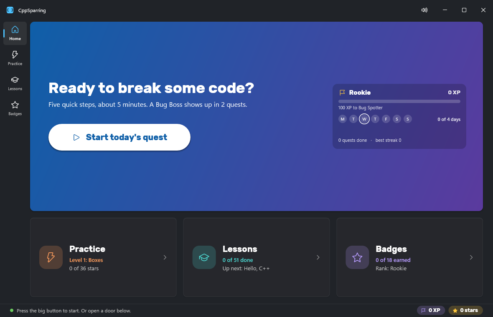
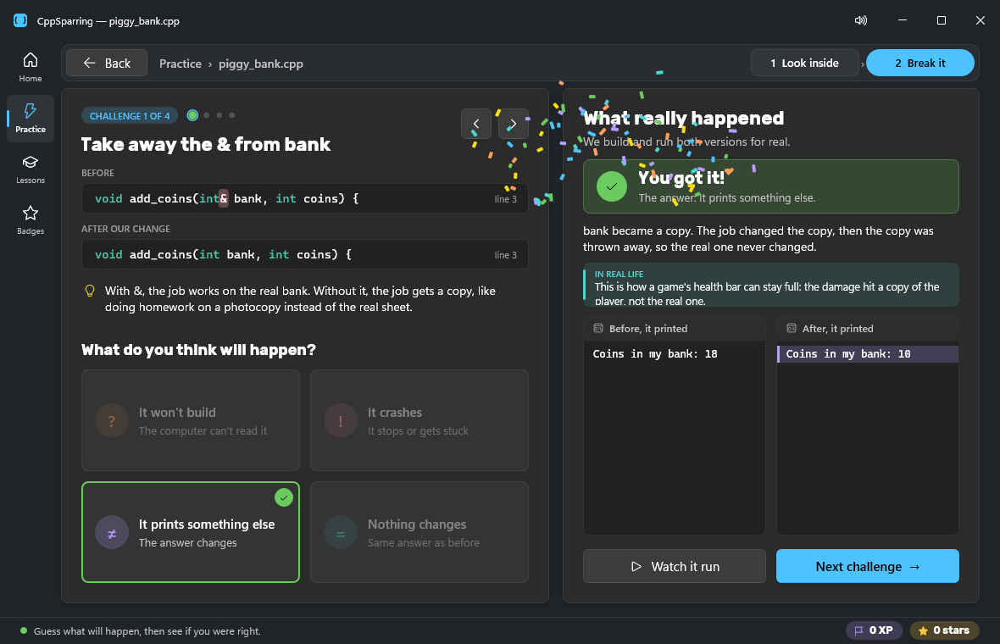
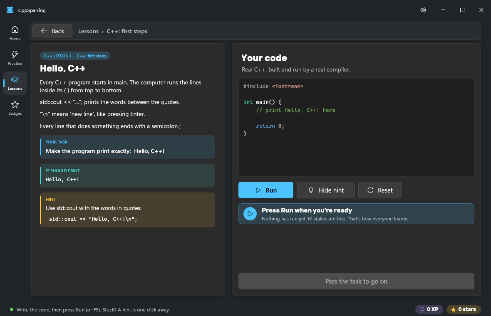
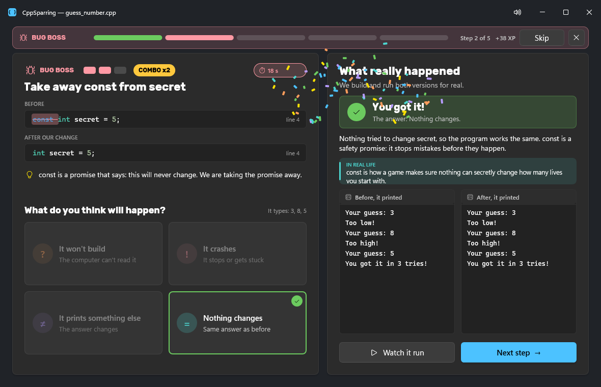

<p align="center"></p>

# CppSparring

**Learn C++ by breaking real programs.**

CppSparring is a Windows 11 app for beginners. It takes a small C++ program, changes one thing about it (takes away a `&`, turns
`==` into `=`, deletes a line), and asks you: *what do you think will happen?* Then it builds and runs both versions for real and
shows you what actually happened, and why.

There is no AI guessing involved. Clang reads the program, the changes come from a fixed set of rules, and every answer comes from
really compiling and running the code.



## What's inside

- **Daily Quest**: one big button, five short steps (about five minutes): a quiz card, a guess, a little code to write, another
  guess, another quiz card. A treasure chest at the end.
- **Bug Boss**: every third quest. Five quick guesses; each right one knocks it back, and right answers in a row build a combo. The
  timer is off unless you switch it on.
- **Practice**: twelve programs in four levels (boxes, jobs, loops, blueprints). Look inside a program first, with every part
  explained in plain words, then try to break it.
- **Watch it run**: step through a program line by line and see every box (variable) change.
- **Lessons**: 12 C++ lessons and 39 C lessons where you write the code yourself and the compiler checks what it prints. The C
  lessons come from [CodingTeacher](https://github.com/mrtitanic777/CodingTeacher).
- **Badges, stars, XP and ranks**, a gentle weekly goal (four days a week, never a broken streak), soft sounds with a mute button,
  confetti, and light and dark themes that follow Windows.

It was designed for learners with ADHD: short loops with a clear end, instant feedback, real-life reasons for every bug, no
penalty for skipping, and nothing to wander off to in the middle of a quest.

| Break it | Watch it run |
|---|---|
|  |  |
| **Write it** | **Bug Boss** |
|  |  |

## Building

You need Windows 10 or 11 and **Visual Studio 2022 or newer** with:

- the **Desktop development with C++** workload (it brings CMake and Ninja), and
- **C++ Clang tools for Windows** (CppSparring uses Clang to read and run programs).

Then run:

```
build.cmd
```

The program is `build\cppsparring.exe`. The `lessons` folder is copied next to it.

## Using it

- Start it and press **Start today's quest**, or pick a program in **Practice**.
- Drag a `.cpp` file onto the window, or open one with **Open my own file**.
- `cppsparring --register-open-with` adds CppSparring to the **Open with** menu for `.cpp` files (for your Windows user only; your
  default program for `.cpp` files stays the same).

Progress is kept in `%APPDATA%\CppSparring\progress.txt`.

## Adding lessons

Lessons are `.json` files in the `lessons` folder, so you can edit them or add your own without rebuilding:

```json
{
  "title": "Hello, C++",
  "language": "cpp",
  "course": 10,
  "number": 1,
  "instructions": ["Every C++ program starts in main.", "- a line starting with a dash is a bullet"],
  "task": "Make the program print exactly:  Hello, C++!",
  "starter_code": "#include <iostream>\n\nint main() {\n    return 0;\n}\n",
  "hint": "Use std::cout:\n\n    std::cout << \"Hello, C++!\\n\";",
  "expected_output": "Hello, C++!",
  "input": ""
}
```

Leave out `language` for C. `input` is what the program reads when it asks you to type (one answer per line). Without
`expected_output`, the lesson passes once the code builds, runs and has been changed.

## For developers

- `cppsparring --selftest LOG` drives the real window, never shown, through a quest, a lesson, a Bug Boss, typed answers and the
  replay, and writes what passed and failed to `LOG`. It uses a throwaway progress file.
- `cppsparring --screenshot OUT.png --page home|practice|look|break|lessons|lesson|quiz|questdone|badges [--file X.cpp|example:N]
  [--guess 0-3] [--replay STEP] [--lesson N] [--run] [--dark]` draws the window into a PNG without showing it.
- `cppsparring --make-icon OUT.ico` redraws the app icon.

## License

[MIT](LICENSE)
